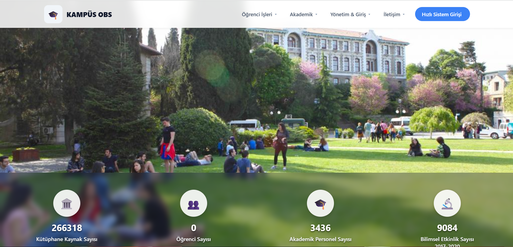
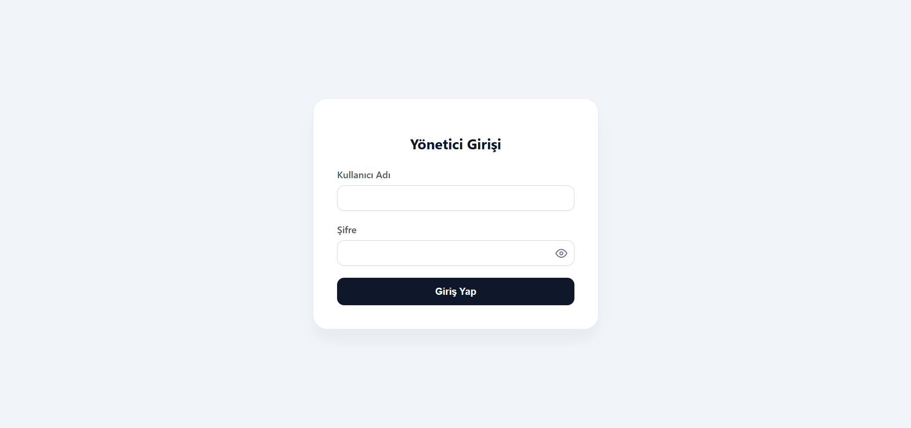
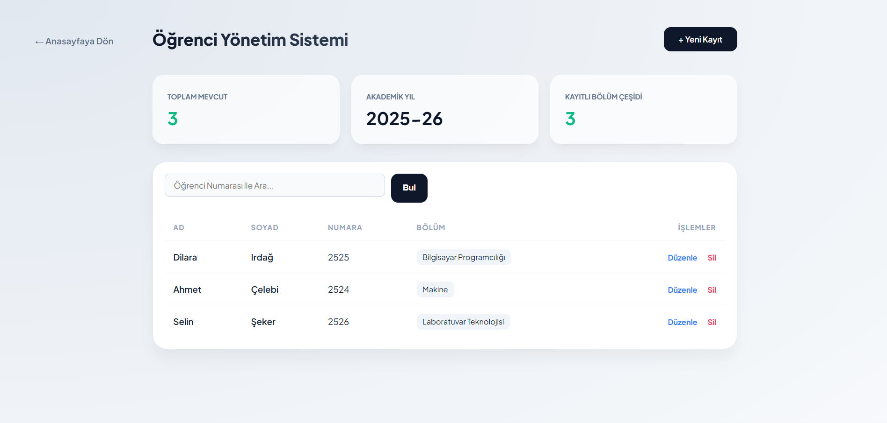
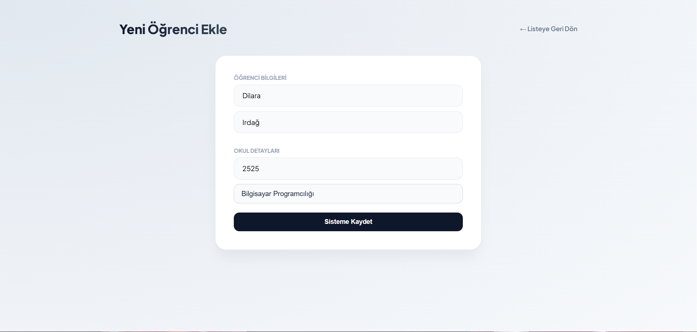

# Kampüs OBS - Öğrenci Yönetim Sistemi

Kampüs OBS, PHP ve MySQL kullanarak geliştirdiğim bir öğrenci yönetim sistemidir. Öğrenci ekleme, listeleme, arama, güncelleme ve silme gibi temel işlemlerin yapılabildiği bir web uygulamasıdır.

## Özellikler

* Yönetici giriş sistemi
* Yeni öğrenci kaydı ekleme
* Öğrencileri listeleme
* Öğrenci numarasına göre arama
* Öğrenci bilgilerini güncelleme
* Öğrenci kaydı silme
* Silme işlemi öncesinde onay penceresi
* Bölüm seçimi ve "Diğer" seçeneği
* Toplam öğrenci ve bölüm sayısını gösterme

## Kullanılan Teknolojiler

* PHP
* MySQL
* HTML5
* CSS3
* JavaScript
* XAMPP
* phpMyAdmin

## Ekran Görüntüleri

### Ana Sayfa


### Yönetici Girişi


### Öğrenci Listesi


### Öğrenci Ekleme


## Proje Klasör Yapısı

```text
Kampus-OBS/
├── screenshots/
│   ├── ana-sayfa.png
│   ├── giris.png
│   ├── ogrenci-ekle.png
│   └── ogrenci-liste.png
├── db.php
├── ekle.php
├── guncelle.php
├── index.php
├── liste.php
├── login.php
├── okul.png
├── okul.sql
├── README.md
├── sil.php
└── style.css

## Kurulum

Projeyi çalıştırmak için XAMPP kullanabilirsiniz.

1. Proje klasörünü XAMPP içerisindeki htdocs klasörüne atın:
   C:/xampp/htdocs/Kampus-OBS

2. XAMPP üzerinden Apache ve MySQL'i başlatın.

3. phpMyAdmin'i açarak okul adında bir veritabanı oluşturun.

4. okul veritabanı içerisinde students ve kullanicilar tablolarını oluşturun.

5. db.php dosyasındaki veritabanı bağlantı bilgilerini kontrol edin.

6. Tarayıcıdan aşağıdaki adrese gidin:
   http://localhost/Kampus-OBS

## Veritabanı

Projede okul isimli MySQL veritabanı kullanılmaktadır.

* students: Öğrenci adı, soyadı, numarası ve bölüm bilgilerini tutar.
* kullanicilar: Yönetici girişinde kullanılan kullanıcı adı ve şifre bilgilerini tutar.

## Geliştirici

Dilara İrdağ